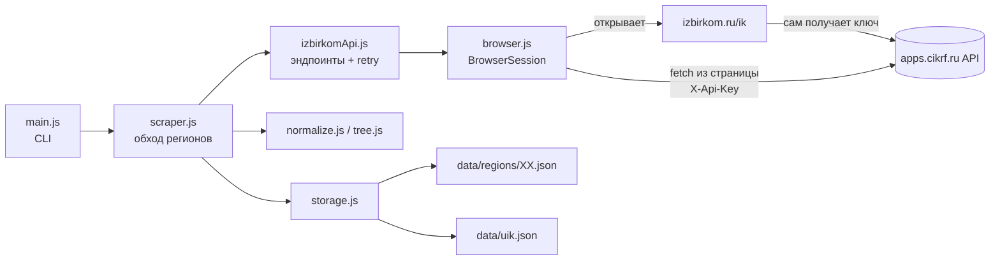

# Архитектура

## Поток данных

1. `BrowserSession.start()` запускает Chrome и открывает `izbirkom.ru/ik?subjectRfCode=01`.
   Код сайта проходит проверку и делает запрос к API с заголовками `X-Api-Key` и
   `X-Client-Fingerprint`. Сессия запоминает их из события `request`.
2. Для каждого субъекта РФ:
   - `GET /commissionOrg?subjectRfCode=XX` возвращает дерево ИКСРФ → ТИК → УИК;
   - ветки с `hasChildren` без детей дозагружаются через `GET /commissionOrg/{id}`;
   - для каждого УИК запрашивается карточка `GET /commissionOrg/{externalId}` (адрес,
     индекс, телефоны, координаты, помещение для голосования, срок полномочий);
   - с флагом `--members` ещё и `GET /reports/42?commissionOrgId=` (состав). Для УИК и ТИК
     он отвечает 404, данные есть только у ИКСРФ.
3. `normalize.js` собирает из ответов плоскую запись. `storage.js` пишет файл региона
   атомарно (tmp + rename).
4. В конце файлы регионов сливаются в `data/uik.json`.

## Обработка ключа

- Ответ `401` запускает обновление доступа: страница перезагружается, сайт получает новый
  ключ.
- Обновление одно на все потоки (общий promise). Остальные потоки ждут его.
- Ключ принимается только во время обновления и только если он отличается от старого.
  Иначе наши собственные запросы со старым ключом перезаписали бы новый (такой баг был
  найден e2e-прогоном, см. `.agent/errors.md`).

## Нагрузка

`mapPool` ограничивает параллельность (по умолчанию 2) и выдерживает паузу между
запросами каждого потока. Ошибки 5xx, 429 и сетевые сбои повторяются с экспоненциальной
паузой. Ошибки 4xx не повторяются.
